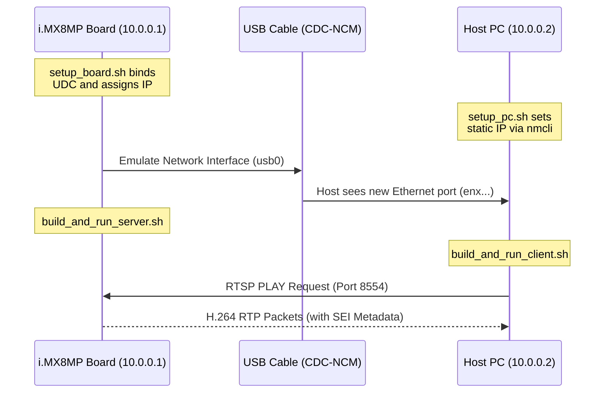

# USB CDC-NCM Ethernet Streaming

This module provides an alternative to the UVC Video Class method. Instead of making the board look like a Webcam to the PC, we configure the board to act as a **Network Adapter** using the USB CDC-NCM protocol. 

This creates a high-speed, dedicated "Ethernet-over-USB" Local Area Network (LAN) between the i.MX8MP board and your Host PC. We then stream the video and SEI metadata over standard TCP/UDP networking (RTSP/RTP).

## Directory Structure
* **`setup_board.sh`**: Runs on the i.MX8MP board. It clears any previous ConfigFS configurations, builds the CDC-NCM gadget, links the MAC addresses, and assigns the board a static IP of `10.0.0.1`.
* **`setup_pc.sh`**: Runs on the Host Linux PC. It uses `NetworkManager` (`nmcli`) to create a persistent static profile for the new USB network interface and assigns the PC an IP of `10.0.0.2`.
* **`build_and_run_server.sh` & `sei_server.c`**: The streaming server application that runs on the board (`10.0.0.1`).
* **`build_and_run_client.sh` & `sei_client.c`**: The receiver client application that runs on the Host PC (`10.0.0.2`).

## Execution Flow

1. **Board Setup:** Run `./setup_board.sh` on the i.MX8MP.
2. **PC Setup:** Connect the USB cable, find your new network interface name (e.g., `enx021122334455`), update `setup_pc.sh` with that name, and run `./setup_pc.sh` on your Host PC.
3. **Start the Server:** Run `./build_and_run_server.sh` on the board.
4. **Start the Client:** Run `./build_and_run_client.sh` on the PC to receive the stream and extract the SEI metadata over the network.

---

## Modifying IPs and Device Nodes (Hardcoded Values)

Currently, the IP addresses and video nodes are **hardcoded** into the source files to ensure the pipeline runs out-of-the-box. If you need to change them, you must edit the files directly:

### 1. Network Subnet (`10.0.0.X`)
If `10.0.0.X` conflicts with your existing network, you must change it in four places:
* **`setup_board.sh`**: Change `ip addr add 10.0.0.1/24` (Line 47)
* **`setup_pc.sh`**: Change `IP="10.0.0.2/24"` (Line 4)
* **`sei_server.c`**: Change `gst_rtsp_server_set_address(server, "10.0.0.1");` (Line 102)
* **`sei_client.c`**: Change `"rtspsrc location=rtsp://10.0.0.1:8554/stream ..."` (Line 60)

### 2. PC Interface Name
* **`setup_pc.sh`**: You **MUST** change `IFACE="enx021122334455"` (Line 3) to match the actual network interface name your Host PC assigns to the USB cable (find this using `ifconfig` or `ip a` after plugging in the board).

### 3. Camera Device
* **`sei_server.c`**: By default, it captures from `/dev/video4`. Change this in the `gst_rtsp_media_factory_set_launch` pipeline (Line 110) if your camera is on a different node.
