# IMU 250 Hz Frequency Analysis & Architectures

This document explores the architectural solution to the core conflict: providing a **>= 250 Hz IMU sample rate** alongside a strict **Maximum sync tolerance <= 1 ms** to the 30 FPS video frame.

## The Core Conflict
The video pipeline operates at **30 FPS (33.3 ms per frame)**.
An IMU operating at 250 Hz generates a sample every **4.0 ms**.

Because SEI metadata must be attached to a video frame, you cannot transmit 250 SEI NAL units per second. You must "batch" the IMU data (approx. 8 to 9 samples per frame). However, standard batching introduces synchronization gaps between the asynchronous camera shutter and the rigid 4ms IMU polling loop.

> [!WARNING]
> **Hardware Magnetometer Limitation**
> The ICM-20948 chip contains an AK09916 magnetometer. According to its datasheet, its absolute maximum continuous Output Data Rate (ODR) is **100 Hz** (Continuous Measurement Mode 4). The magnetometer physically cannot produce 250 unique samples per second. Any 250 Hz model will result in the magnetometer values being duplicated across 2 or 3 consecutive samples (while Accel and Gyro will successfully provide unique 250 Hz data).

---

## Architectural Models & Trade-offs

### 1. 30 Hz Frame-Locked Inline
The IMU is sampled synchronously (via IOCTL) inside a zero-latency GStreamer pad probe the exact microsecond the 30 FPS frame hits user-space.
*   **Pros:** Mathematically guarantees sub-1ms sync tolerance. Extremely low CPU overhead.
*   **Cons:** Fails the 250 Hz frequency requirement (provides exactly 30 Hz).

### 2. Standard Background Batching: 250 Hz Polling
A dedicated `pthread` polls the IMU every 4 ms and saves the data to a software array. When the 30 FPS frame arrives, the accumulated array (~8 samples) is embedded into the SEI payload.
*   **Pros:** Meets the 250 Hz requirement.
*   **Cons:** **Fails the <= 1 ms sync tolerance requirement.** Because the camera shutter fires asynchronously to the 4ms polling loop, the closest IMU sample to the frame could be up to **2.0 ms** away (half the polling interval).

### 3. Hardware FIFO Batching
The ICM-20948 internal hardware FIFO is configured to automatically sample at exactly 250 Hz. When the 30 FPS frame arrives, the software issues a bulk IOCTL to drain the hardware FIFO.
*   **Pros:** Lowest CPU polling overhead (interrupt driven). Perfect 250 Hz timing without thread jitter.
*   **Cons:** Because 250Hz is mathematically faster than 30Hz, we cannot rely on a 1:1 mapping. If we inject one IMU sample per video frame, we will lose ~220 samples every second.

```mermaid
gantt
    title Hybrid Array Mapping (30FPS vs 250Hz)
    dateFormat  s
    axisFormat  %S
    
    section Camera (30Hz)
    Frame 1 (0ms) :a1, 0, 33ms
    Frame 2 (33ms) :a2, 33, 33ms
    Frame 3 (66ms) :a3, 66, 33ms

    section IMU (250Hz)
    Sample 1 (0ms) :active, 0, 4ms
    Sample 2 (4ms) :active, 4, 4ms
    Sample 3 (8ms) :active, 8, 4ms
    Sample 4 (12ms) :active, 12, 4ms
    Sample 5 (16ms) :active, 16, 4ms
    Sample 6 (20ms) :active, 20, 4ms
    Sample 7 (24ms) :active, 24, 4ms
    Sample 8 (28ms) :active, 28, 4ms
```



## Current Implementation: Model 1 (30Hz Frame-Locked Inline)

The code in `uvc_sei_injection.h` implements **Model 1**. When a 30 FPS video frame hits the GStreamer pad probe, a single synchronous IOCTL (`ICM20948_IOC_GET_ALL`) is issued to `/dev/icm20948`. This takes approximately **200–360 µs**, which is well within the < 1 ms sync tolerance target.

The `SeiMetadata` struct (in `include/sei_metadata.h`) stores exactly **one IMU sample** per frame — a single set of `accel_x_mg`, `gyro_x_mdps`, and `mag_x_ut` values. There is **no background thread** and **no sample array**.

```
Effective IMU rate = 30 Hz (one sample per video frame)
Sync tolerance    = < 1 ms ✅
CPU overhead      = Minimal (no threads, no polling loop) ✅
250 Hz requirement = NOT met by current implementation ❌
```

---

## Future Roadmap: Hybrid Array Model

To satisfy a true 250 Hz requirement while keeping < 1 ms sync tolerance, the Hybrid Array Model is the proposed upgrade path:

1. **Background Polling Thread:** A dedicated `pthread` polls the IMU at 250 Hz (every 4 ms) and accumulates readings into a ring buffer.
2. **Inline Frame Sync:** The pad probe still issues one synchronous IOCTL at the exact frame moment for the time-critical `Sample[0]`.
3. **Array SEI Payload:** `SeiMetadata` is extended to hold an array of ~8 samples. `Sample[0]` is the frame-synced read. `Sample[1..7]` are the background polled samples from the past 28 ms.

This would require:
- Expanding `sei_metadata.h` from a single IMU sample to an array struct.
- Adding a background `pthread` to `uvc_sei_injection.h`.
- Updating the extractor (`sei_extractor`) to iterate over the array.


---

## Alternative Solutions (Bypassing SEI)

### Option A: Sidecar Files (MP4 + CSV + JSON)
If the goal is purely **recording** (or analyzing post-capture) rather than live USB streaming, Option A completely bypasses the SEI complexities.
1.  **`video.mp4`**: The GStreamer pipeline records the 30 FPS video. No SEI injection is performed.
2.  **`imu.csv`**: A dedicated C program loops at 250 Hz, reading the IMU and writing directly to a CSV file. Every row contains the exact `CLOCK_MONOTONIC` timestamp.
3.  **`meta.json`**: Records the exact `CLOCK_MONOTONIC` base time when the MP4 recording started.

**How Synchronization is Proven (The Math):**
Because the MP4 video timestamps start at `0`, for any frame at time $T_{relative}$ in the MP4, its true hardware time is:
$$T_{absolute} = T_{base\_time} + T_{relative}$$
You simply look up $T_{absolute}$ in the `imu.csv` to find the exact IMU samples captured at that microsecond. This trivially supports 250 Hz without any SEI limitations.
